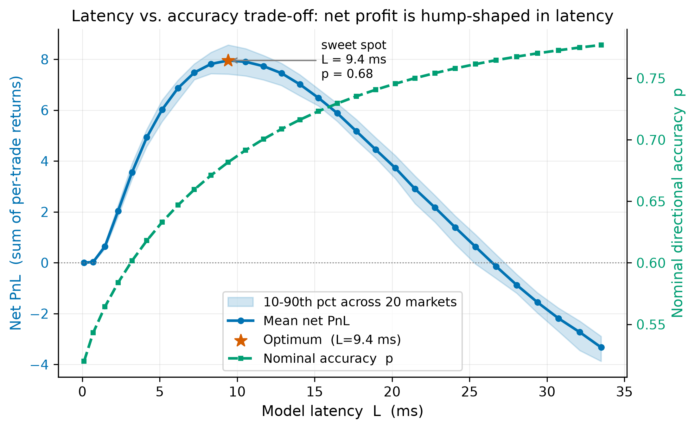
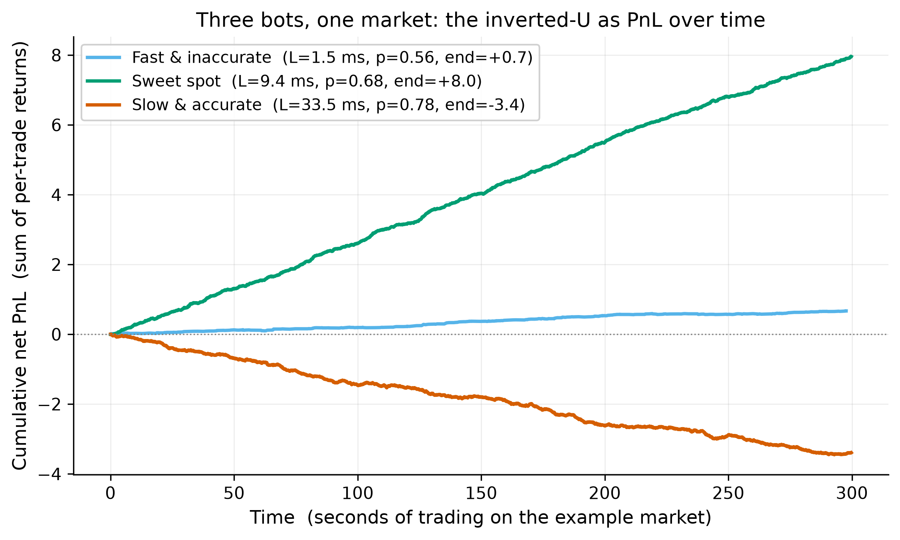
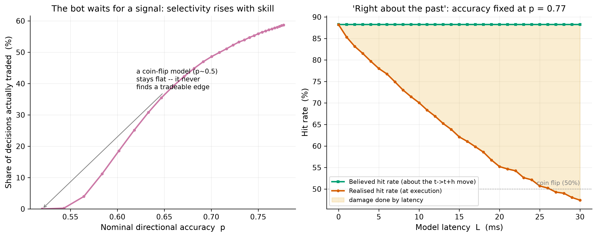
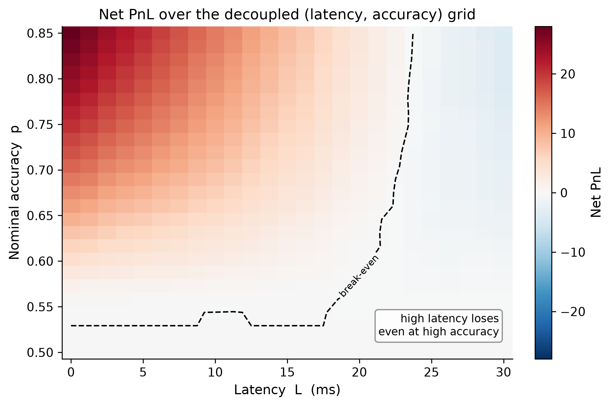
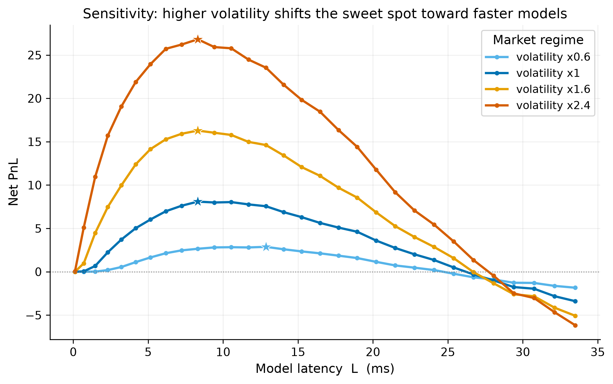
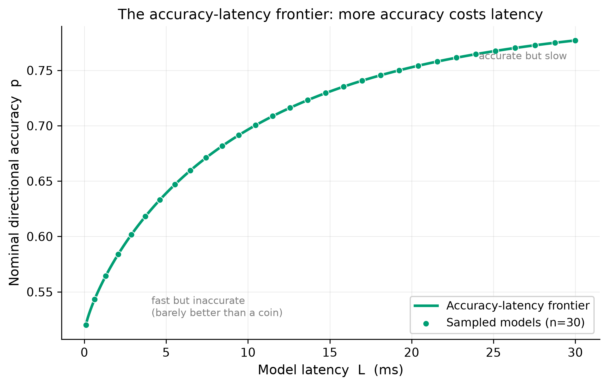
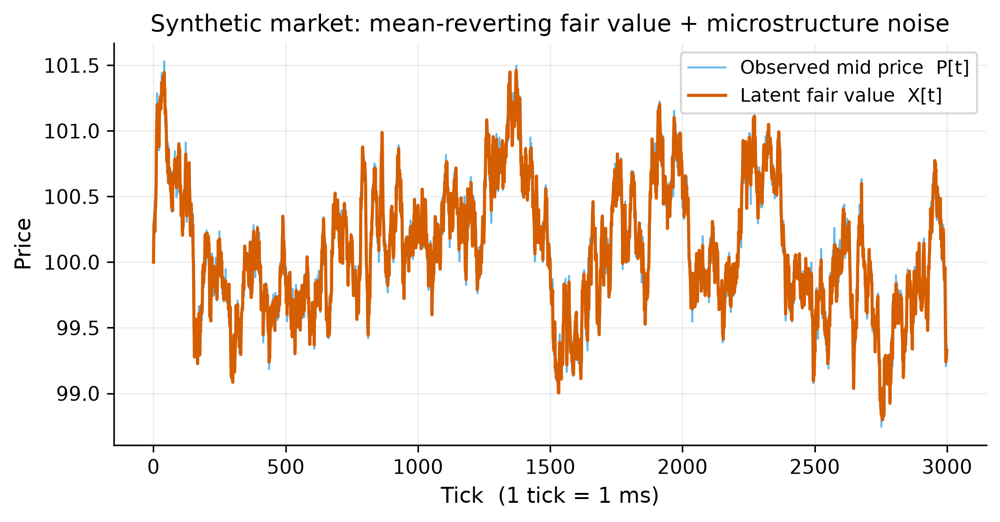
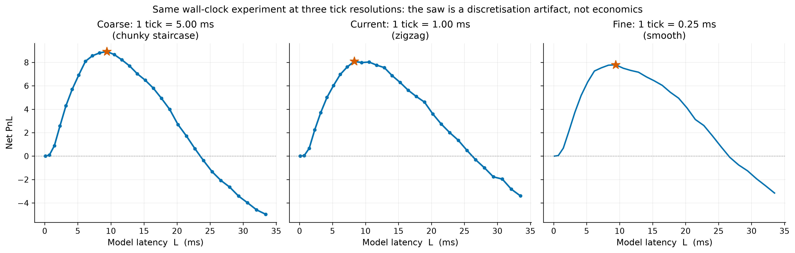

# Latency vs. Accuracy in Real-Time Trading AI

A reproducible simulation showing that a trading model's net profit is **hump-shaped in inference latency**: the fastest models are too inaccurate to find an edge, the most accurate models are filled too late to capture the move they predicted, and the optimum sits in between.

The simulation accompanies a seminar paper on latency/accuracy trade-offs in real-time AI systems for algorithmic trading, written from a software-engineering perspective. It uses synthetic data and an abstracted model. It is **not** a trading system and **not** financial advice.



## Results

All numbers below are produced by `python run.py --all` with the default `config.yaml` (seed `20260620`) and are byte-for-byte reproducible.

| Finding | Value |
|---|---|
| Profit-maximising latency on the frontier | **≈ 9.4 ms** (nominal accuracy 0.68), averaged over 20 independent markets |
| Peak mean net PnL (95 % CI) | 7.95 [7.77, 8.14] |
| Latency at which a 0.77-accuracy model's *realised* hit rate drops below a coin flip | **≈ 27 ms**, while its *believed* hit rate stays at 0.88 |
| Break-even latency along the frontier | ≈ 26 ms, despite accuracy still rising |
| Effect of 2.4× volatility | Peak PnL 3.3× higher, optimum shifts to faster models |

**Three bots, one market.** The same inverted-U told as three cumulative PnL paths: a fast-but-inaccurate model stays flat, the sweet-spot model climbs steadily, and the slow-but-accurate model loses money despite being right about the direction more often.



**Right about the past.** With accuracy held fixed, the model's *believed* hit rate (how often it is right about the move it bet on) is flat in latency, but its *realised* hit rate (whether the trade was profitable after the late fill) decays toward and below 50 %. The shaded gap is the pure cost of being late.



**Decoupled grid.** Sweeping accuracy and latency independently shows that beyond a latency threshold, no amount of accuracy recovers profit.



**Volatility sensitivity.** Higher volatility raises the stakes and moves the sweet spot toward faster models.



<details>
<summary>More figures: the frontier, the synthetic market, and the tick-resolution check</summary>





</details>

## How it works

1. **Synthetic market.** A latent fair value follows a mean-reverting Ornstein–Uhlenbeck process with rare jumps, observed through microstructure noise.
2. **Abstracted model.** Each "AI model" is a point `(accuracy p, latency L)` on a frontier where more complex models are more accurate but slower.
3. **Signal gating.** The model emits a noisy continuous signal and trades only when its believed edge clears the spread and fee by a safety margin. A coin-flip model therefore stays flat; trade count is an output, not a schedule.
4. **Latency-aware execution.** A decision made at tick `t` is filled at `t + L` at the price prevailing then, crossing the bid/ask spread, and closed after a fixed horizon. Because short-horizon prices mean-revert, a late fill enters after the predicted move has begun to reverse.
5. **Sweeps.** The frontier is swept across 20 market seeds with common random numbers, so every curve is smooth and every comparison is fair.

The whole mechanism lives, heavily commented, in `src/backtest.py`.

## Key features

- Fully deterministic: one global seed in `config.yaml`, byte-identical outputs on every run.
- Every parameter (market, costs, frontier, jitter, gating, sweep ranges) lives in `config.yaml`. No magic numbers in code.
- Fat-tailed per-trade latency jitter, bid/ask spread, exchange fee, and optional slippage, all config-toggleable.
- Multi-seed confidence bands on the headline figure.
- Vectorised NumPy backtest: the full pipeline runs in about 6 s on a laptop CPU.
- Publication-quality figures saved as PDF and PNG with a colour-blind-safe palette.
- Unit tests, including one that asserts the profit peak is interior (genuinely hump-shaped).

## Tech stack

Python 3.11+, NumPy, pandas, SciPy, Matplotlib, PyYAML, pytest. CPU only, no ML frameworks, no network access.

## Run it

```bash
git clone https://github.com/sinanhalef/latency-accuracy-tradeoff-sim.git
cd latency-accuracy-tradeoff-sim
python3 -m venv .venv
source .venv/bin/activate        # Windows: .venv\Scripts\activate
pip install -r requirements.txt

python run.py --all              # regenerate every figure and table (~6 s)
pytest -q                        # run the test suite
```

Individual experiments and the standalone figures:

```bash
python run.py --experiment 1     # inverted-U with multi-seed band
python run.py --experiment 2     # decoupled (latency, accuracy) heatmap
python run.py --experiment 3     # signal gating + believed-vs-realised hit rate
python run.py --experiment 4     # volatility sensitivity
python make_bot_paths.py         # three bots' cumulative PnL on one market
python make_frontier.py          # the assumed accuracy-latency frontier
python make_resolution_comparison.py   # the sweep at 5 / 1 / 0.25 ms ticks
```

Outputs are written to `outputs/figures/` and `outputs/tables/`.

## Project structure

```
.
├── run.py                        # CLI: python run.py --all
├── config.yaml                   # every tunable parameter, commented
├── requirements.txt
├── make_bot_paths.py             # standalone figure scripts
├── make_frontier.py
├── make_resolution_comparison.py
├── src/
│   ├── market.py                 # OU fair value + noise + jumps
│   ├── model.py                  # (accuracy, latency) frontier and signal generation
│   ├── backtest.py               # latency-aware execution engine and metrics
│   ├── experiments.py            # the sweeps
│   └── plotting.py               # figure code
├── tests/                        # pytest suite
└── docs/images/                  # figures shown in this README
```

## Limitations

- **Synthetic data.** A simple OU process with Gaussian noise and rare jumps, not real order-book data.
- **Abstracted model.** Accuracy is a knob, not the output of a trained network. There is no real inference and no measured wall-clock latency.
- **Stylised execution.** Unit position size, a single holding horizon, no queue position, partial fills, or market impact. The bot gates on its believed edge but does not account for its own latency, so it can overtrade stale signals. That is a deliberate teaching point.
- **Not a trading recommendation.** The project demonstrates a known mechanism in a controlled setting and should not be used to trade.

## License

MIT. See [LICENSE](LICENSE).
